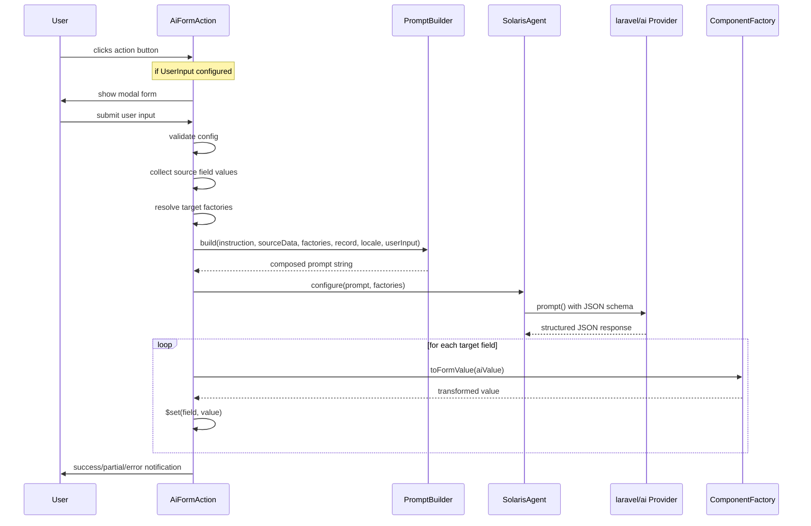
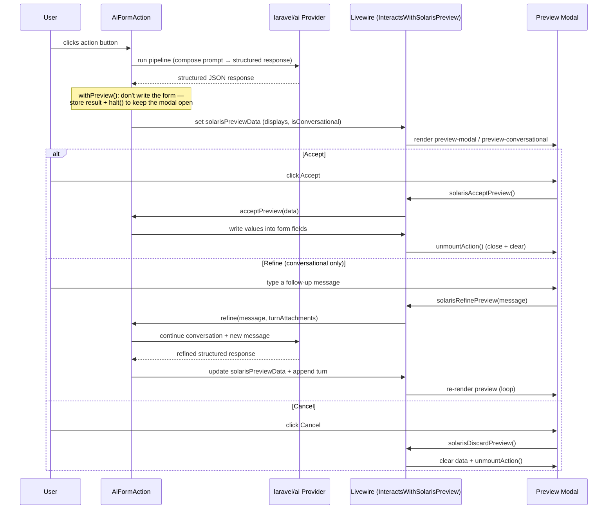
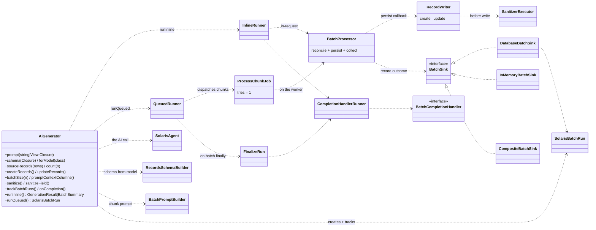
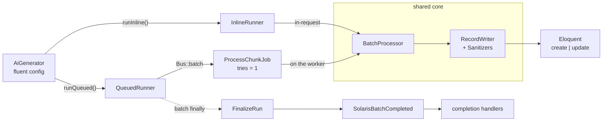
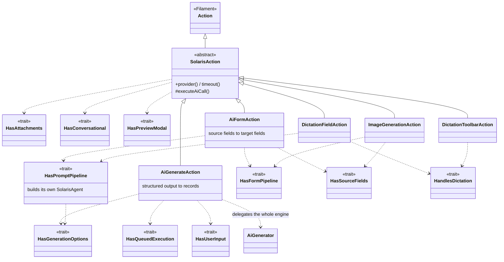
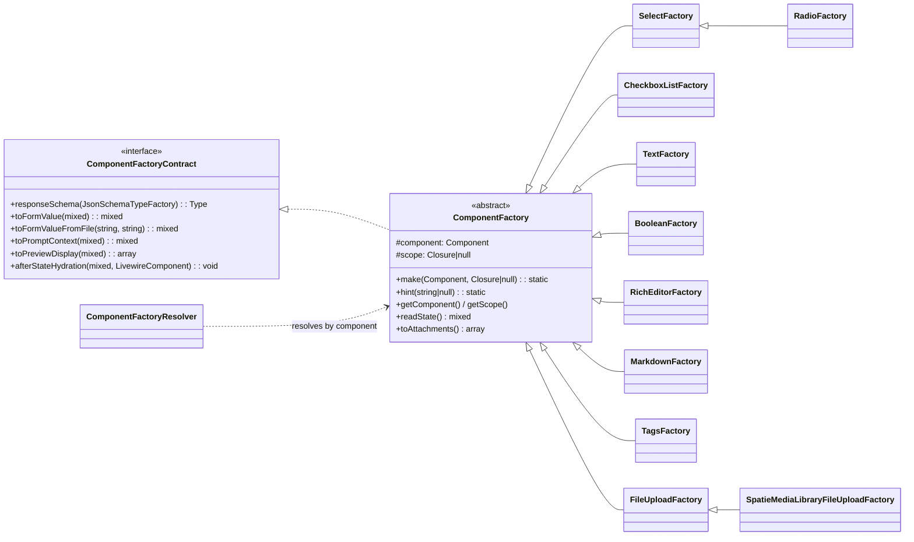
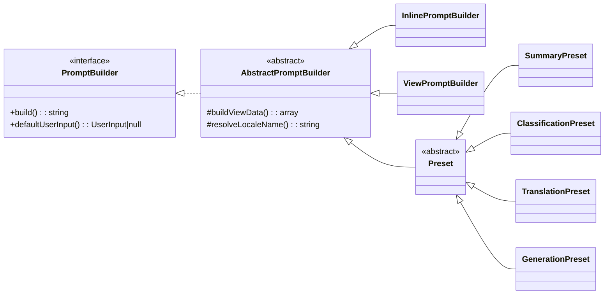
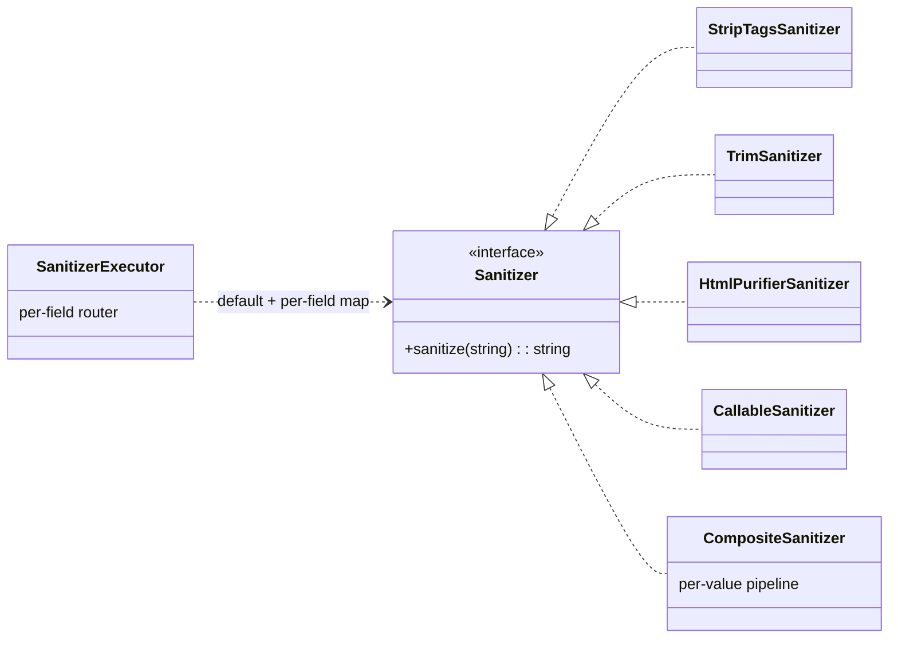

# Architecture

[← Back to README](../README.md)

## Execution Pipeline

This is the direct path. With `->withPreview()` the result isn't written immediately — it's parked for the user to review, per the next diagram.

## Preview & Conversational Refinement

When `->withPreview()` (or `->conversational()`, which implies it) is set, the pipeline runs the AI call but **defers the write**: the structured result is stored on the Livewire component's `solarisPreviewData` and the action `halt()`s so the modal stays open. The user then accepts, refines, or cancels. This requires the [`InteractsWithSolarisPreview`](ai-form-action.md#preview) trait on the host Livewire component, which provides the methods the modal dispatches to.

The refine loop re-runs the AI with the new message appended to the conversation (via `laravel/ai`'s `RemembersConversations`); each turn replaces the preview until the user accepts. See [Conversational Refinement](ai-form-action.md#conversational-refinement) for the requirements (migrations, authenticated user) and lifetime semantics.

## The Generation Engine

`AiGenerator` is the headless core: a fluent builder with two terminals. Everything below
it is Filament-free and runs identically from a controller, a listener, an artisan command
or a queue worker.

Both runners reach the same `BatchProcessor` and `CompletionHandlerRunner` — the queued
path simply goes one hop further out, through `ProcessChunkJob` and `FinalizeRun`.

## Inline vs Queued

The inline and queued paths are not two implementations. They share the processor, the
writer, the schema builder and the prompt builder; `runQueued()` only moves the agent call
onto a worker and wraps the chunks in a `Bus::batch`.

The only structural difference is the boundary the AI call sits behind. Queued mode always
persists a `SolarisBatchRun`, because the run row is the one place per-chunk outcomes can
aggregate.

## The Action Layer

Every action extends `SolarisAction`, which extends Filament's `Action` and carries the
capabilities all of them share. Below that, the traits split along *what the action writes
to*.

The asymmetry is deliberate, up to a point: `AiGenerateAction` hands the entire engine to
the service, while `AiFormAction` still runs its own agent inside `HasPromptPipeline`.
Form write-back, preview and conversational refinement stay Filament-side either way.

## Component Hierarchy

Factories translate between a Filament component and an AI-shaped value. `responseSchema()`
contributes one property to the response schema; `toFormValue()` maps the returned value
back to form state; the write itself is done by the caller through Filament's `Set`
utility.

> The interface is `Statikbe\FilamentSolaris\Contracts\ComponentFactory`; the abstract base
> is `Statikbe\FilamentSolaris\Factories\ComponentFactory`. The base defaults four of the
> six methods, so a custom factory normally implements only `responseSchema()`,
> `toFormValue()` and `toPromptContext()`. See [Factories](factories.md).

## Prompt Builders & Presets

Presets *are* prompt builders — that inheritance is what makes them reusable wherever a
prompt is accepted. See [Presets](presets.md) and [Prompt Builders](prompt-builders.md).

## Sanitizers

Sanitizers clean a string on its way to storage. Two roles that are easy to conflate:
`CompositeSanitizer` is a **per-value pipeline** (trim, then strip tags, on one string),
while `SanitizerExecutor` is a **per-field router** (a default plus a per-field map, run
across a whole attribute map). A field's sanitizer may itself be a composite.

See [Security](security.md) for when each applies.
